# Actividad 8 - Tacho: Lotería Doloreña (Desarrollo Guiado por Pruebas — TDD)

##  Acerca de la práctica
Esta actividad consiste en el desarrollo integral del juego tradicional **Lotería Doloreña** (adaptado con cartas temáticas de Dolores Hidalgo y la Independencia de México) aplicando estrictamente la metodología **TDD (Test-Driven Development)**[cite: 3]. 

Todo el sistema fue construido desde una carpeta vacía y de forma incremental: primero escribiendo las pruebas unitarias e de integración (viendo el fallo en **rojo**), luego implementando el código mínimo para hacerlas pasar (**verde**), y finalmente montando la interfaz gráfica de usuario en Flutter[cite: 3].

---

##  Pruebas y Evidencias (Ronda por Ronda)

A continuación se detallan cada una de las pruebas desarrolladas, explicando su objetivo y mostrando la evidencia fotográfica del ciclo TDD (Fallo / Éxito).

---

###  Prueba / Ronda 1: La Baraja Completa
* **Descripción de la prueba:** Verificar que al invocar `crearBarajaCompleta()` se obtenga exactamente una lista con 16 cartas únicas, sin repetir ningún identificador[cite: 3].

| Evidencia de Fallo (Rojo) | Evidencia de Éxito (Verde) |
| :---: | :---: |
| 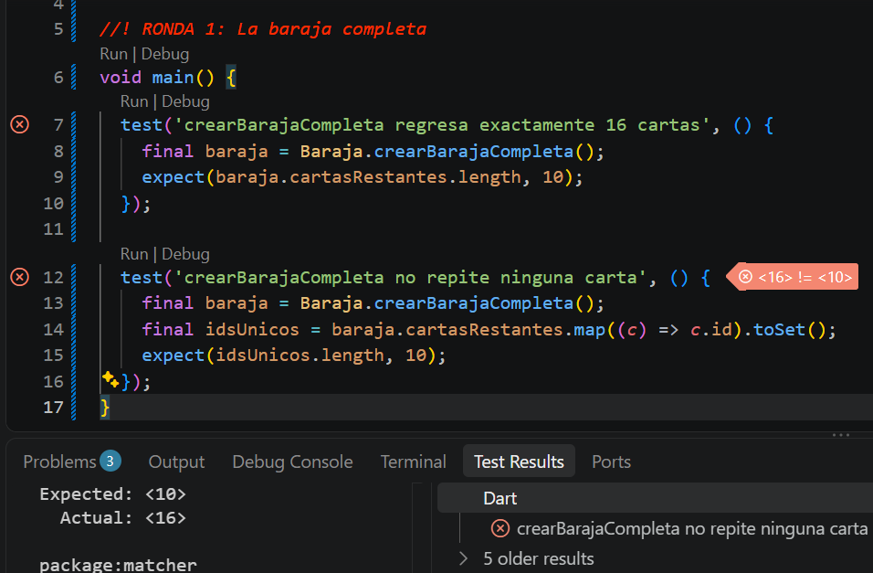 | 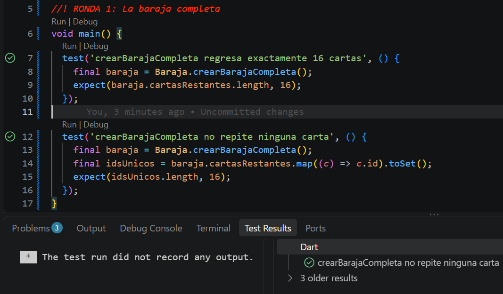 |

---

###  Prueba / Ronda 2: Barajar Baraja
* **Descripción de la prueba:** Comprobar que el método `mezclar()` reordene las cartas de manera aleatoria pero garantizando que se conserven exactamente las mismas 16 cartas iniciales sin perder ni duplicar ninguna[cite: 3].

| Evidencia de Fallo (Rojo) | Evidencia de Éxito (Verde) |
| :---: | :---: |
| 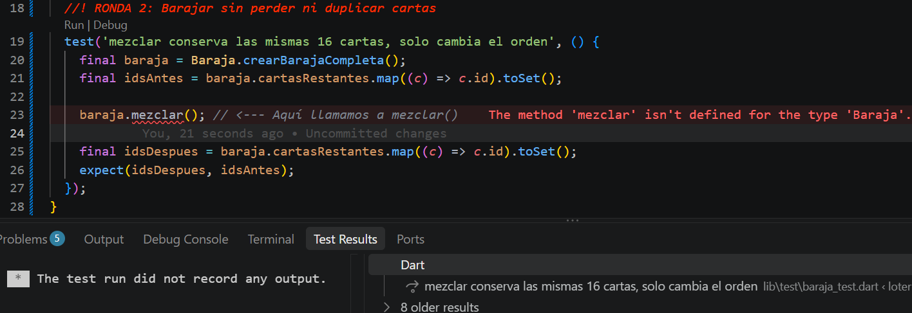 | 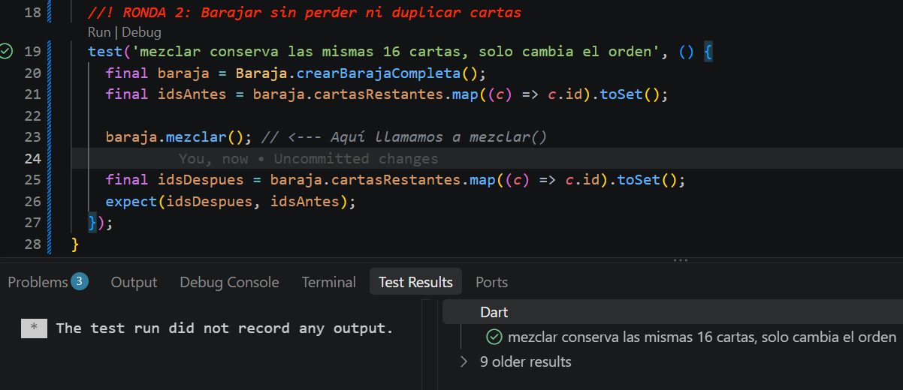 |

---

###  Prueba / Ronda 3: Cantar Cartas
* **Descripción de la prueba:** Validar que la función `cantarSiguiente()` entregue la carta correspondiente retirándola del mazo de forma eficiente, y que devuelva `null` de manera controlada cuando el mazo se quede vacío[cite: 3].

| Evidencia de Fallo (Rojo) | Evidencia de Éxito (Verde) |
| :---: | :---: |
| 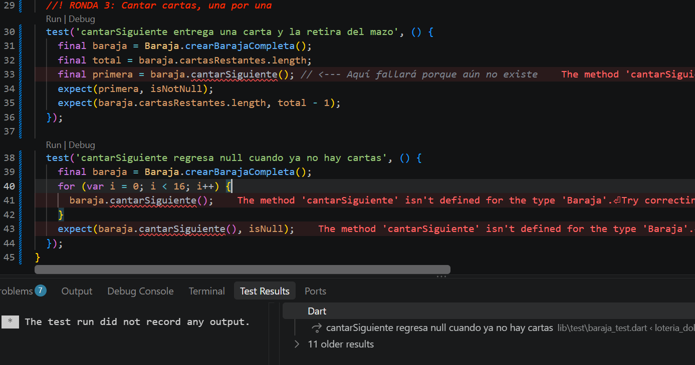 | 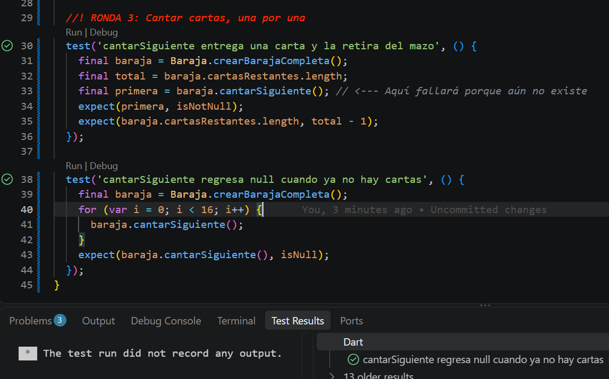 |

---

###  Prueba / Ronda 4: Generación de la Tabla 4x4
* **Descripción de la prueba:** Asegurar que la clase `Tabla` genere una cuadrícula de 4x4 con las 16 cartas barajadas sin repetición, iniciando con una matriz espejo de puros valores `false` (ninguna casilla marcada)[cite: 3].

| Evidencia de Fallo (Rojo) | Evidencia de Éxito (Verde) |
| :---: | :---: |
| 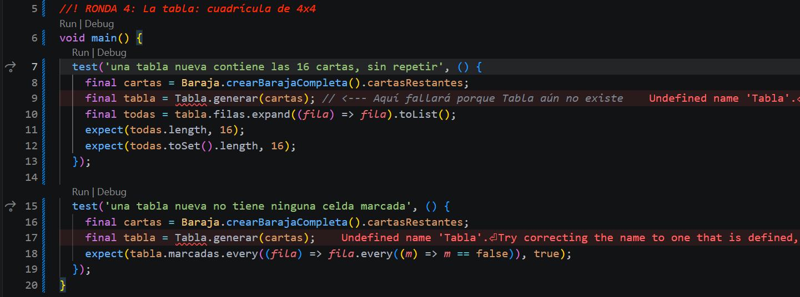 | 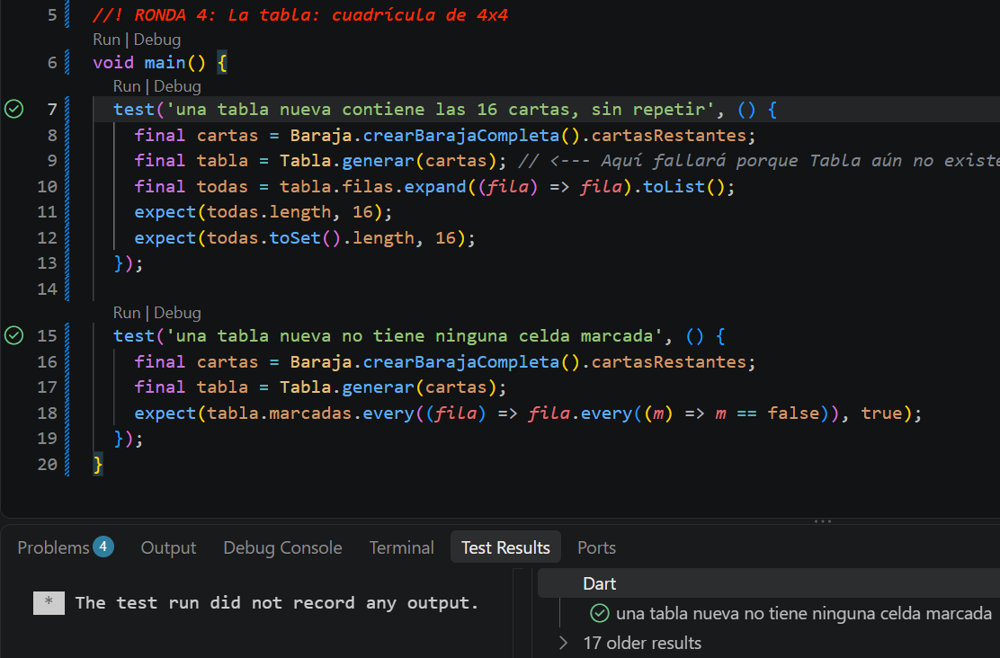 |

---

###  Prueba / Ronda 5: Marcar Celdas en la Tabla
* **Descripción de la prueba:** Comprobar que al recibir una carta cantada, el método `marcar()` la busque en la cuadrícula y cambie el estado de su celda a `true` (marcada), ignorando cartas ajenas o inexistentes[cite: 3].

| Evidencia de Fallo (Rojo) | Evidencia de Éxito (Verde) |
| :---: | :---: |
| 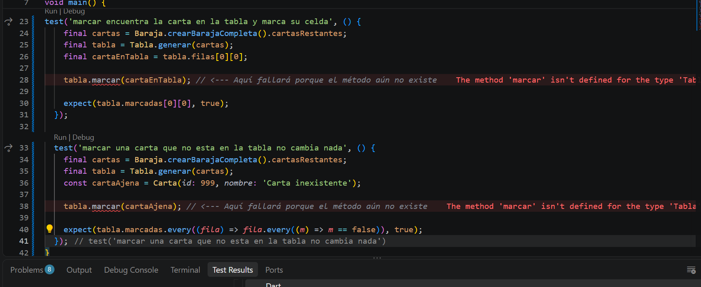 | 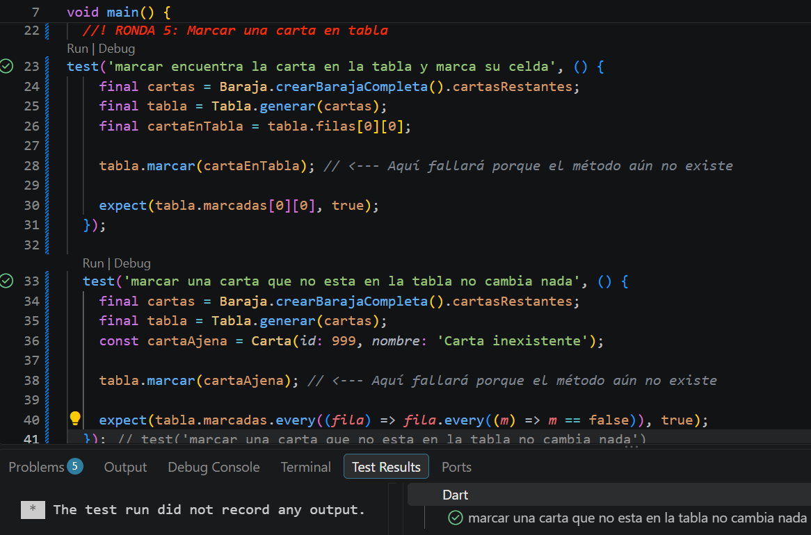 |

---

###  Prueba / Ronda 6: Verificador de Líneas Horizontales
* **Descripción de la prueba:** Validar que el `VerificadorPatrones` detecte de forma correcta cuando una fila horizontal completa de la tabla cuenta con todas sus casillas marcadas[cite: 3].

| Evidencia de Fallo (Rojo) | Evidencia de Éxito (Verde) |
| :---: | :---: |
| 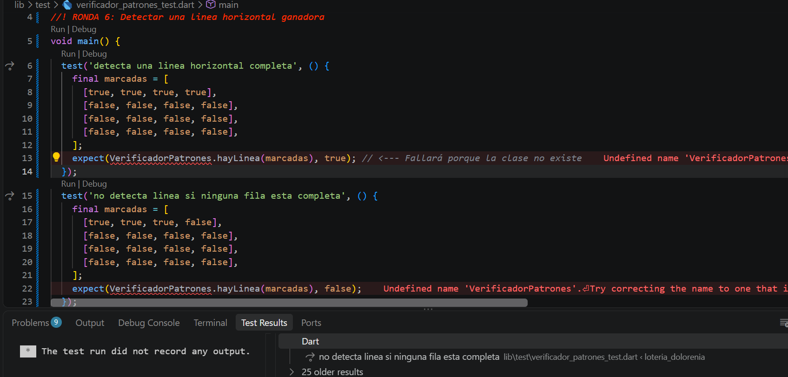 | 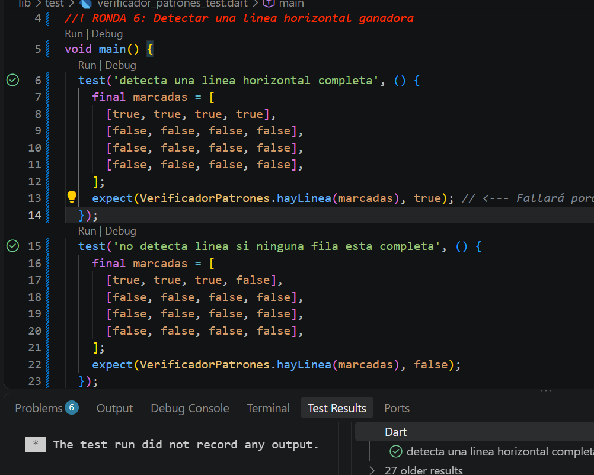 |

---

###  Prueba / Ronda 7: Verificador de Columnas Verticales
* **Descripción de la prueba:** Comprobar la detección exitosa de una columna vertical completa de arriba a abajo dentro de la matriz de marcadas[cite: 3].

| Evidencia de Fallo (Rojo) | Evidencia de Éxito (Verde) |
| :---: | :---: |
| 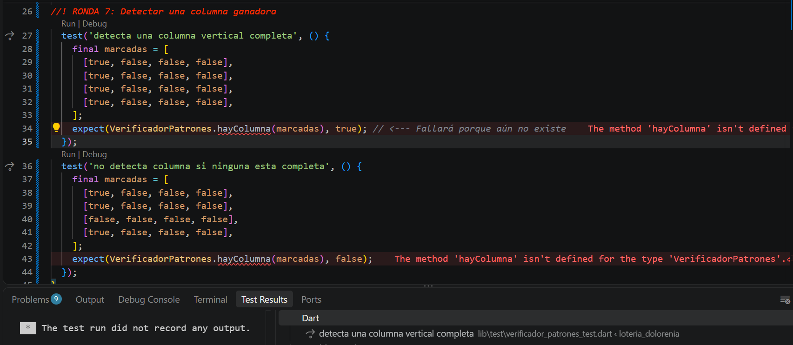 | 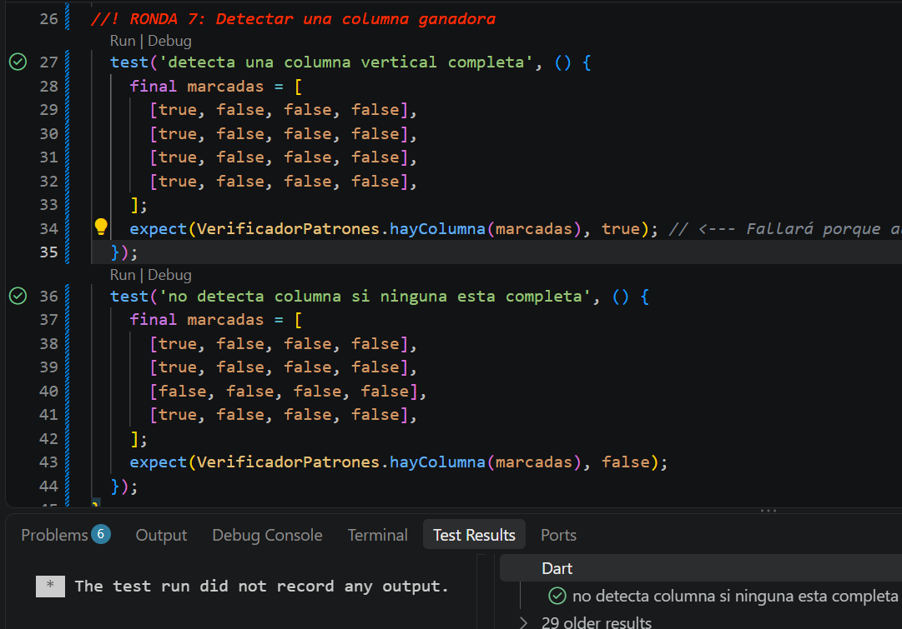 |

---

###  Prueba / Ronda 8: Verificador de Diagonales
* **Descripción de la prueba:** Asegurar que el sistema identifique correctamente la victoria al completarse la diagonal principal o la diagonal secundaria[cite: 3].

| Evidencia de Fallo (Rojo) | Evidencia de Éxito (Verde) |
| :---: | :---: |
| 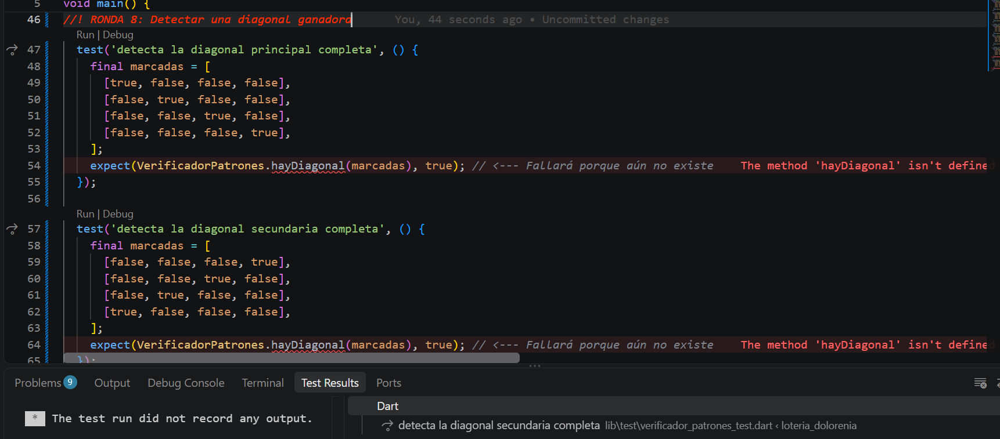 | 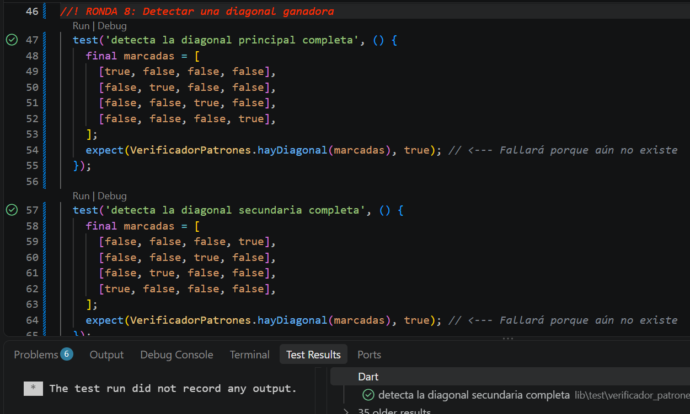 |

---

###  Prueba / Ronda 10: Integración del Motor de Juego
* **Descripción de la prueba:** Prueba de integración general del `MotorJuego`. Valida que al cantar las cartas sucesivas, estas se marquen automáticamente y el motor detecte la victoria en cuanto se completa un patrón válido[cite: 3].

| Evidencia de Fallo (Rojo) | Evidencia de Éxito (Verde) |
| :---: | :---: |
| 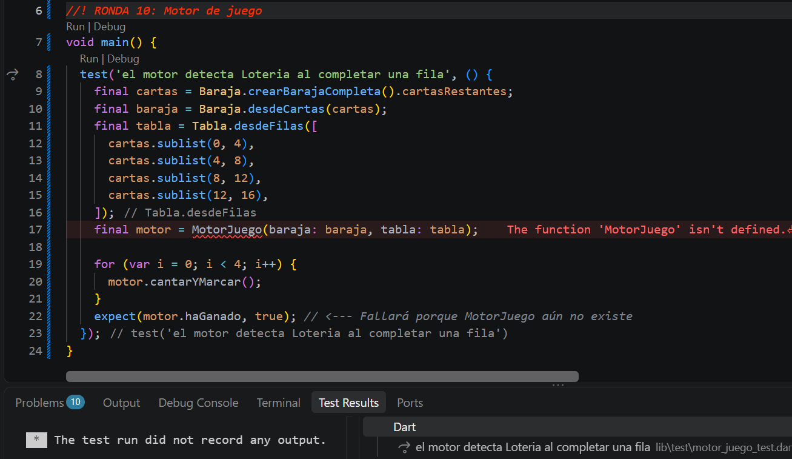 | 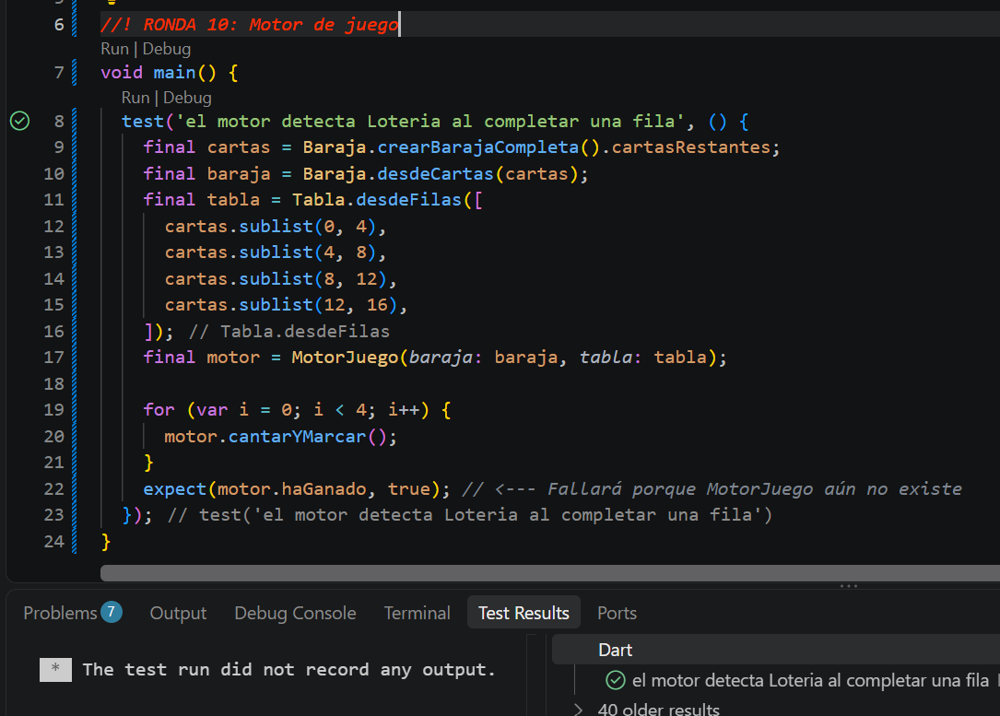 |

---

##  Ejecución y Demostración Visual de la App

Para correr las pruebas unitarias desde tu terminal:
```bash
flutter test